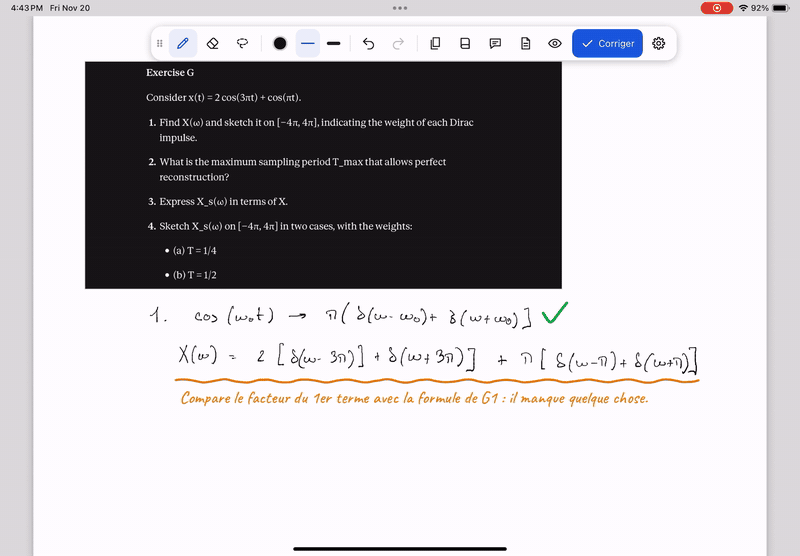
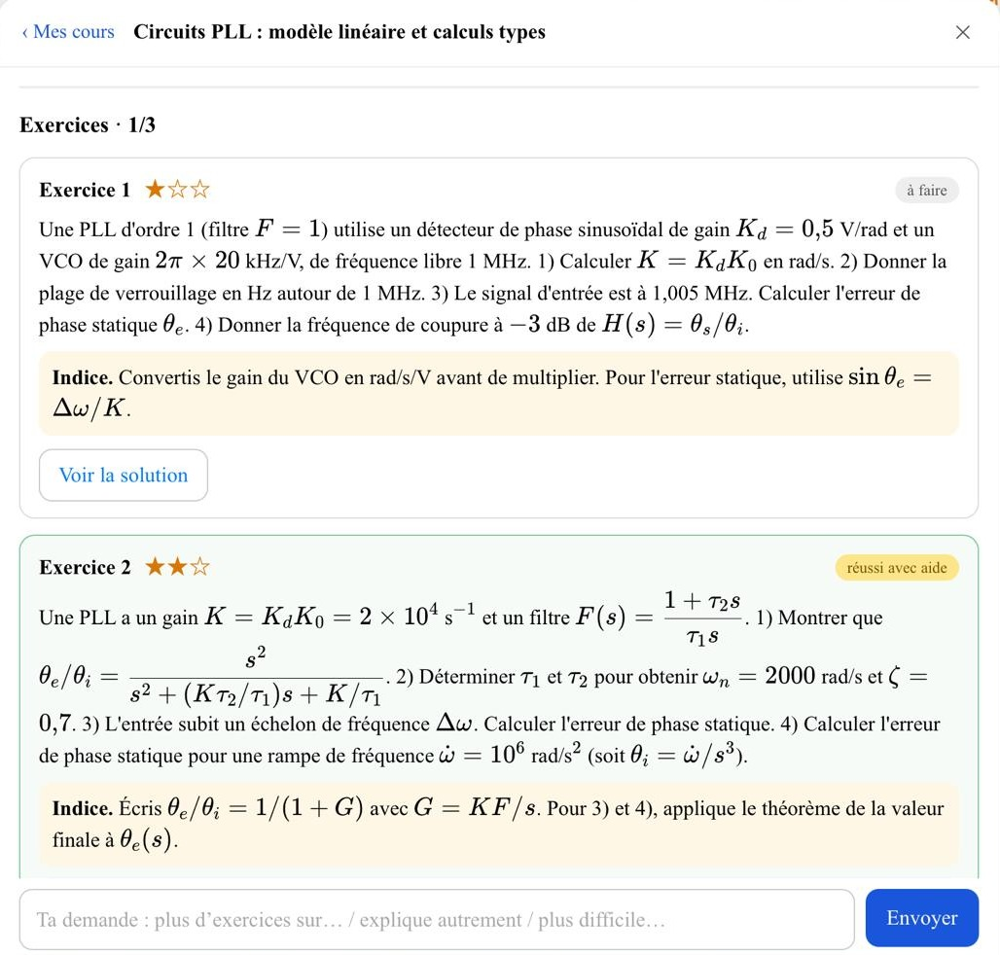
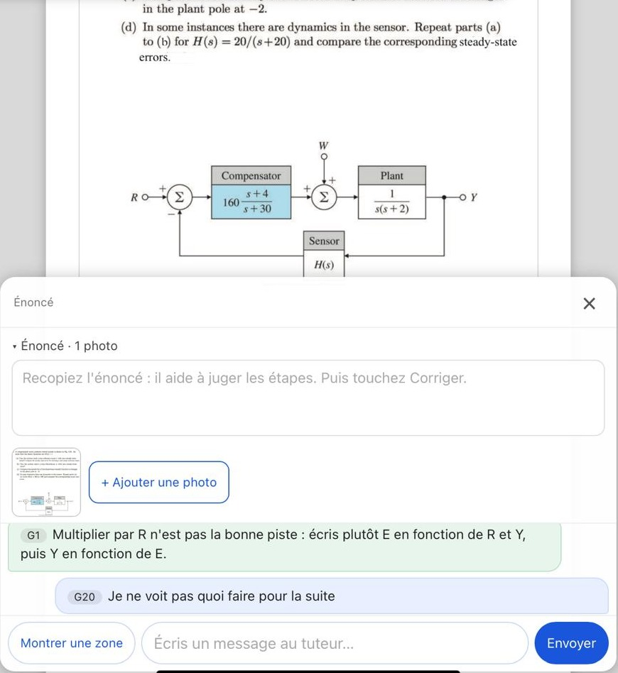
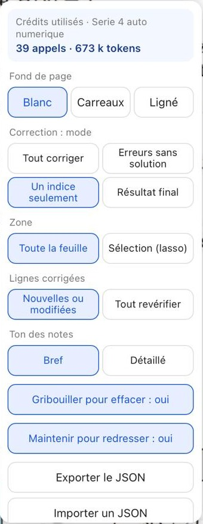
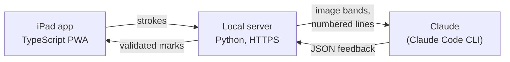

# Handwritten AI tutor

An iPad notebook where I solve exercises with the Apple Pencil, and Claude corrects my working **line by line, directly on the page**, at the level of help I choose.

▶ **[Full demo video (57 s)](docs/Demo_tuteur_IA.mp4)** · 📄 **[Two-page project summary (PDF)](docs/Portfolio_tuteur_IA.pdf)**

## Why

Working through exercises alone, feedback comes too late or all at once. A full solution skips the learning; no feedback lets mistakes settle in. I wanted a tutor that reads my handwritten working and says *just enough*.

## What it does

- **Pen-first notebook** (installable PWA): palm rejection, lasso, scribble-to-erase, straighten-by-holding, autosave, pages, export/import.
- **One "Correct" button.** Claude draws its feedback on the sheet: red circles on errors, green ticks, hints in the margin.
- **Four levels of help**: full correction, errors without the answer, a single hint, or final result only. It can check a lasso selection, and only re-checks lines that changed.
- **Conversation with the tutor**: circle a zone and ask "why?", or tell it it misread your writing; the marks on the page update.
- **Problem photos** sent along with the sheet, and **generated courses** with graded exercises, hints and hidden solutions.

| Generated course | Statement photo + conversation | Settings |
|---|---|---|
|  |  |  |

## How it works

The server groups strokes into lines, renders the sheet as image bands with each line framed and numbered, and asks Claude for structured feedback that is validated before it reaches the page. Each line carries a geometric fingerprint, so feedback follows a line when it moves and is dropped when it is rewritten. If nothing changed, no call is made.

## What I measured

My first pipeline turned handwriting into LaTeX (OCR) before sending text to Claude. I benchmarked two open models on my own sheets (median character error 0.05 vs 0.18), then questioned the OCR itself with a **blind test**: a sheet with deliberate errors, 6 pipelines × 2 modes × 3 runs, 105 annotations graded before revealing which pipeline was which.

| Pipeline ("full correction" mode) | Errors found |
|---|---|
| Handwriting → text (OCR) | 50% |
| OCR text + image | 72% |
| Image, whole page | 83% |
| **Image, 3 bands (kept)** | **94%** |

No false alarms on that sheet for any pipeline. The OCR text was misleading Claude, and with images a second verification pass confirmed 47/47 errors while only adding time, so production uses images only: about **11–15 s per correction**. Small sample (one writer, 26 lines): the gaps in errors found are clear, the differences in annotation quality are not.

## Stack

TypeScript (Vite, perfect-freehand, KaTeX, IndexedDB) · Python (stroke grouping, rendering, benchmark, 30+ tests) · Claude via the Claude Code CLI.

Built with Claude Code as a pair programmer: I set the specs, planned each step and tested every feature on the iPad. `CLAUDE.md` is the project log kept between sessions (in French).

## Run it locally

See [docs/SETUP.md](docs/SETUP.md) (in French): `npm run reco` for the correction server, `npm run pwa` for the app, HTTPS with mkcert for the iPad.

---
Brieuc · BSc Microengineering, EPFL
